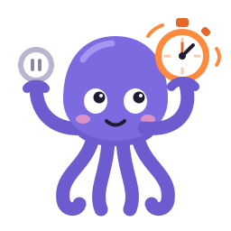
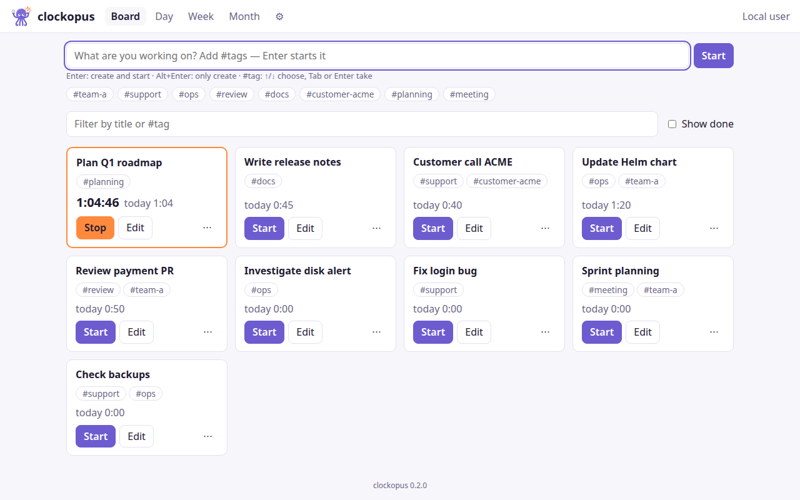
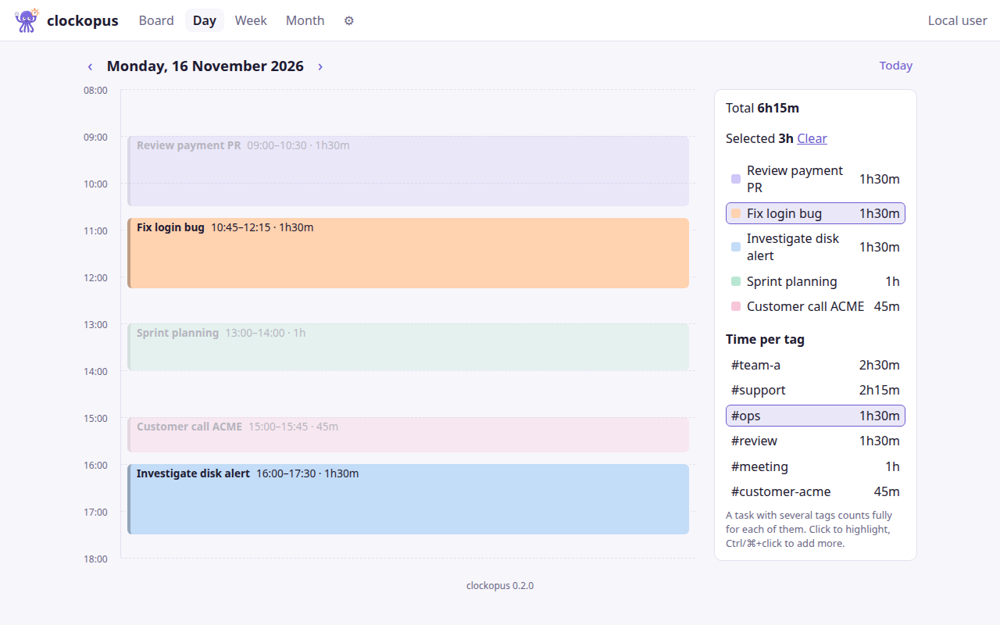
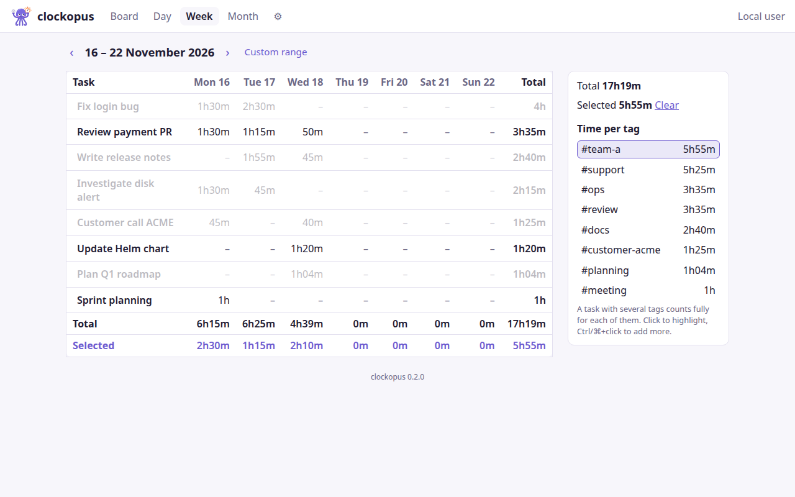
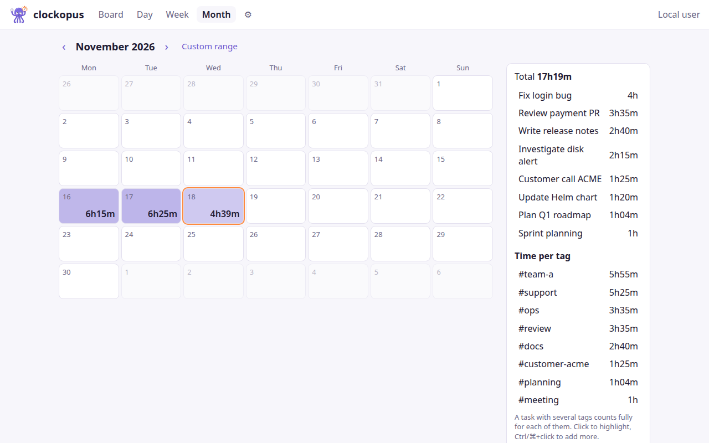
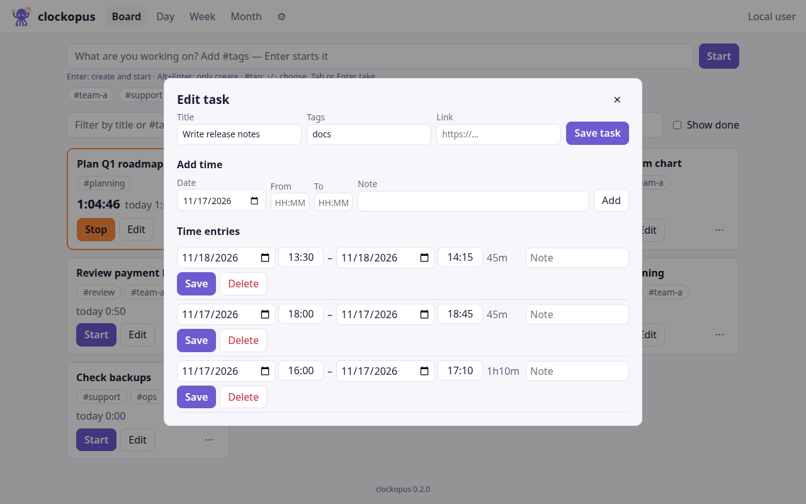
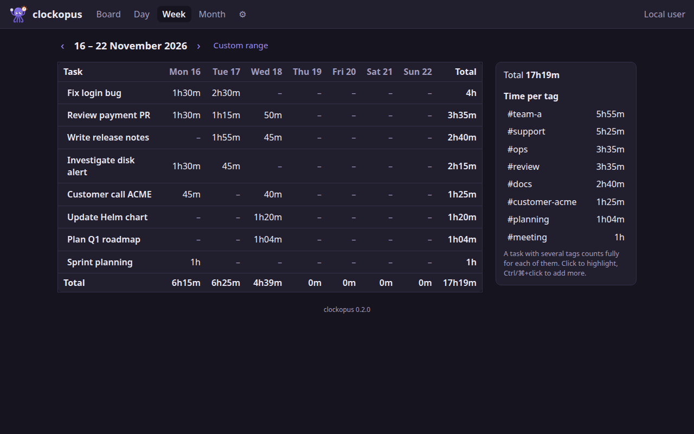

<p align="center">
  
</p>

<h1 align="center">clockopus</h1>

<p align="center"><b>A fast personal time tracker for people who switch context all day.</b></p>

---

> **Status:** in use. Releases with image and Helm chart:
> [GitHub releases](https://github.com/ChiliChonka/clockopus/releases). Tasks and timer, quick add
> with `#tags`, corrections with history, the forgotten-timer prompt, day/week/month reports with
> highlighting, CSV and data export/import, YAML or PostgreSQL storage, sign-in with OpenID
> Connect.
> What is planned and in which order: [docs/SPEC.md](docs/SPEC.md), architecture:
> [docs/adr/0001-architecture.md](docs/adr/0001-architecture.md).

## The idea

Developers, operators and application owners rarely work on one thing for long. A review here, a
support question there, back to the feature, then a call. At the end of the day the question
“where did my time go?” has no good answer, and most time trackers make it worse: they want
projects, clients and billing codes before you can press start.

clockopus is the opposite. It is a **personal** tool for your own time management:

- **One click to switch.** Every task is a card with a start button. Starting a task pauses the
  one that was running, because you only ever do one thing at a time.
- **Seconds to create a task.** Type `Review payment PR #review #team-a`, press Enter, and the
  task exists and runs. Tags are optional.
- **Forgiving.** Forgot to press stop yesterday? clockopus tells you the next morning and offers
  a one-click correction. Add or fix times by hand whenever you like; every correction is kept in
  a short history.
- **Honest answers.** See per day, week or month which tasks took your time, and how many hours
  went into each tag.
- **Yours only.** Nobody else sees your times: no team view, no manager dashboard. You can export
  everything and take it with you.

## What it covers

| Area | What you get |
|---|---|
| Tasks | Cards sorted by last use, pin favourites, mark done (hidden from the board, kept in reports), optional link (e.g. a ticket) |
| Timer | Start/stop per card, exactly one running timer, running time in the browser tab title |
| Manual times | Add, edit and delete time entries per task in 24-hour form (`930` → `09:30`); overlaps are rejected; every change keeps the previous value |
| Forgotten timer | Detected the next day or after a configurable number of hours; correct it with one click |
| Tags | Per user, always lower case, quick-access bar with your most used tags, auto-completion when creating tasks (`↑`/`↓`, `Tab`, `Enter`) |
| Reports | Day timeline (drag to correct), week grid, month calendar; totals per task and time per tag as `1h30m`; click a task or tag to highlight its time, `Ctrl`/`⌘`+click for more |
| Export | CSV per time range (optional rounding), full data export/import as YAML |
| Sign-in | Any OpenID Connect provider; the first login creates the account, no approval needed |

**Not covered, on purpose:** team or manager views, billing and invoices, projects or clients as
an extra layer (tags do that), approvals, reminders by email, idle detection.

## Screenshots

| Board | Day |
|---|---|
|  |  |
| **Week** (tag `#team-a` highlighted) | **Month** |
|  |  |
| **Edit a task** (times in 24-hour form) | **Dark mode** |
|  |  |

## How it runs

clockopus is a single container: a Rust (Axum) backend that also serves the Angular frontend.

| | Try it out | Real installation |
|---|---|---|
| Install | `docker compose up` | Helm chart from `oci://ghcr.io/chilichonka/charts/clockopus` |
| Sign-in | none (one built-in local user) | OpenID Connect (e.g. Keycloak) |
| Storage | YAML files you can read yourself: `tasks.yaml`, `tags.yaml` | PostgreSQL |

The YAML files are meant to be read: times are written as local time with offset, tags by name.
You can analyse them with any script you like.

### Try it out

```sh
git clone https://github.com/ChiliChonka/clockopus.git
cd clockopus
docker compose up --build
```

Then open <http://localhost:8080>. Without sign-in the port is only reachable from your own
machine. The container runs as user `1000:1000` so the files in `./data` belong to you; if
`id -u` says otherwise, start it with `CLOCKOPUS_UID=$(id -u) CLOCKOPUS_GID=$(id -g) docker compose up --build`.

With PostgreSQL instead of YAML files:

```sh
docker compose -f compose.yaml -f compose.postgres.yaml up --build
```

## Development

Requirements: Rust (version pinned in `backend/rust-toolchain.toml`), Node.js 24,
[Task](https://taskfile.dev), Docker.

| Command | Purpose |
|---|---|
| `task backend:run` | Backend on http://localhost:8080 without sign-in, data in `./data` |
| `task frontend:run` | Angular dev server on http://localhost:4200 (API proxied to :8080) |
| `task check` | Formatting, lint, all tests, builds, image — what CI runs (starts a PostgreSQL test container) |
| `task db:test` / `task db:test:stop` | Start / remove the PostgreSQL test database on 127.0.0.1:55432 |
| `task backend:run:oidc` | Backend with sign-in and PostgreSQL: starts a local Keycloak (`task dev:keycloak`, users `anna`/`anna` and `ben`/`ben`) and the test database |
| `task dev:keycloak:stop` | Remove the local Keycloak |

To try sign-in: build the frontend once (`cd frontend && npx ng build`), then run
`task backend:run:oidc` and open <http://localhost:8080>. The realm in
`deploy/dev/keycloak-realm.json` is for development only.

Working rules for contributors and coding agents: [AGENTS.md](AGENTS.md).

## License

[Apache License 2.0](LICENSE)
